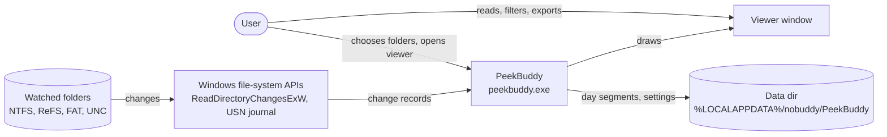
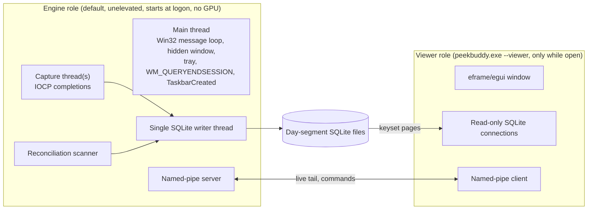
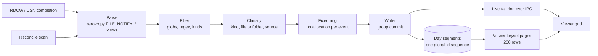

# Architecture

PeekBuddy watches the folders you choose and logs every change in real time.
This page says what exists and how the parts fit together. The reasons live
in the [ADRs](adr/README.md); the numbers live in
[PERFORMANCE.md](../PERFORMANCE.md).

## System context

PeekBuddy makes no network connections, needs no admin rights and installs
no service or driver (v1 non-goals in #1).

## Containers: one exe, two roles

- **Engine** is what runs all day. It owns the tray icon, the watches, the
  reconciliation scanner and the only writer. It never links eframe, egui,
  winit, wgpu or glow, so its footprint stays small ([ADR 0001](adr/0001-two-process-single-exe.md)).
- **Viewer** starts on demand from the tray, reads the segments through
  read-only connections and receives the live tail over the pipe. Closing it
  gives all its memory back.
- Each role holds its own single-instance mutex `Local\PeekBuddy.{GUID}`. A
  second `--viewer` launch forwards "show viewer" to the running one.

## Data flow

- **Group commit** (R1): the writer waits a short coalescing window (default
  5 ms) and commits at the latest after 1,000 events or 100 ms.
- **Raw is truth** (F3): one row per raw record. Rename stitching, atomic-save
  detection and coalescing are views over the raw rows
  ([ADR 0003](adr/0003-raw-is-truth.md)).
- **Zero undetected loss** (F2): an overflow becomes a gap row and triggers a
  reconciliation scan of the subtree
  ([ADR 0002](adr/0002-source-agnostic-capture-and-zero-undetected-loss.md)).
- **Ids** (R2): one global contiguous event id sequence across all day
  segments, so a gap in ids is a bug, never a rotation artefact.

## Crate map

| Crate | Builds on Linux | `unsafe` | Owns |
| --- | --- | --- | --- |
| `peekbuddy-core` | yes, tested there (Miri, fuzz) | forbidden | event model, kinds, names, filters, derived views |
| `peekbuddy-win` | OS-independent parsers only | allowed | `windows-sys =0.61.2` wrappers, FILE_NOTIFY/USN record views, Win32 traits with fakes |
| `peekbuddy-store` | yes | forbidden | SQLite segments, schema, writer, queries, export |
| `peekbuddy-engine` | logic yes, Win32 parts no | forbidden | capture threads, writer thread, reconcile scanner, tray, pipe server |
| `peekbuddy-viewer` | no | forbidden | eframe window, grid, filters, pipe client |
| `peekbuddy` | no | forbidden | the single bin: engine by default, `--viewer` for the viewer |
| `xtask` | yes | forbidden | churn generator, perf harness, repo checks, release helpers |
| `benches` | yes | forbidden | micro-benchmarks |

Thread ownership: the engine's main thread runs the message loop and the
tray; `peekbuddy-engine` spawns the capture threads and the reconcile
scanner; `peekbuddy-store` owns the writer thread. The viewer's main thread
is eframe's.

## Runtime feature gates

APIs newer than Windows 10 22H2 are detected at runtime, never assumed
([ADR 0013](adr/0013-supported-windows-and-cpu-baseline.md), [SUPPORT.md](../SUPPORT.md)):

- `ReadDirectoryNotifyFullInformation` (Windows 11 22H2+), falling back to
  `ReadDirectoryNotifyExtendedInformation` (Windows 10 1709+), then to plain
  `ReadDirectoryChangesW` (F4).
- `DWMWA_USE_IMMERSIVE_DARK_MODE` = 20, `DWMWA_WINDOW_CORNER_PREFERENCE` = 33,
  `DWMWA_SYSTEMBACKDROP_TYPE` = 38 (Mica). `E_INVALIDARG` means
  "unsupported" and is never an error.
- The tray-overflow first-run hint is shown only on Windows 11.
- Unprivileged USN reading depends on the outcome of spike #31.

## Where things live

- Data: `%LOCALAPPDATA%\nobuddy\PeekBuddy\`, always excluded from watching
  ([ADR 0008](adr/0008-data-dir-and-self-exclusion.md)).
- Decisions: [docs/adr/](adr/README.md).
