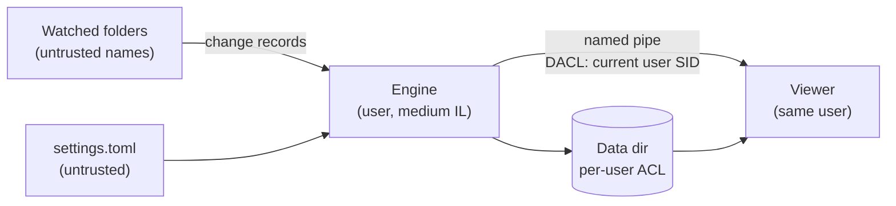

# Threat model

PeekBuddy v1 runs unelevated, makes no network connections and stores
everything per user. This page lists what it protects, where trust changes,
and what it does not defend against.

## Assets

- **File names and paths** of the watched folders: they can reveal what a
  person works on.
- **The event log**: the day-segment SQLite files under
  `%LOCALAPPDATA%\nobuddy\PeekBuddy\` ([ADR 0008](../adr/0008-data-dir-and-self-exclusion.md)).
- **Exports**: CSV and JSON Lines files the user writes on request.

## Trust boundaries

- Engine and viewer run as the same user. The named pipe has an explicit DACL
  that grants only the current user SID, is created with
  `FILE_FLAG_FIRST_PIPE_INSTANCE` (no squatting by an earlier server) and
  `PIPE_REJECT_REMOTE_CLIENTS` (#61).
- No network, no telemetry, no update checks, no elevation, no service and no
  driver in v1.
- The data directory inherits the per-user ACL of `%LOCALAPPDATA%`.

## Untrusted input

| Input | Risk | Handling |
| --- | --- | --- |
| File names in watched folders | Lone surrogates, bidi and other Cf characters that spoof the display; very long paths | Stored losslessly ([ADR 0009](../adr/0009-name-fidelity.md)); the viewer escapes bidi and Cf characters; parsers are fuzzed (#17) |
| Change records from Windows | Malformed or truncated buffers | Bounds-checked zero-copy parser (#44), fuzzed |
| `settings.toml` | Invalid or hostile values | Versioned schema with validation; invalid files are reported, never half-applied (#62) |
| IPC messages | A same-user process sending malformed frames | Length-prefixed frames with limits; unknown messages rejected (#61) |
| SQLite segments | Edited or corrupted files | Opened read-only by the viewer; integrity check on open (#57) |

## Out of scope

- An attacker who runs code as the same Windows user: they can read the data
  directory and the folders anyway.
- Administrators and SYSTEM.
- Physical access to an unlocked session.
