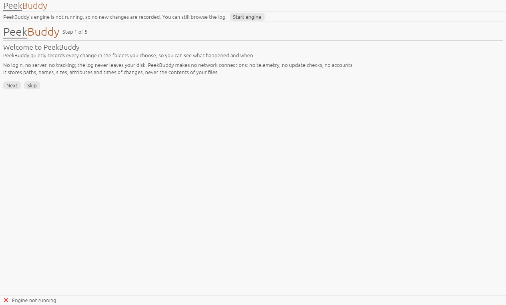

# Getting started

This walks through the first ten minutes with PeekBuddy: starting it, watching
a folder and finding a change in the log. It assumes Windows 11 (x64 or
arm64) and the zip from the release page, checked against the
`SHA256SUMS` file that comes with it.

## 1. Start it

Unpack the zip anywhere you like and run `peekbuddy.exe`. Windows may warn
about an unsigned program the first time (v1 ships unsigned, see
[ADR 0012](../adr/0012-code-signing.md)). PeekBuddy has no installer and makes
no network connection.

Two things start: the **engine**, which has no window and lives in the
notification area, and the **viewer**, the window you are looking at. The
engine keeps recording when the window is closed.

## 2. The welcome screens

The first time, PeekBuddy shows five short screens. You can skip them at any
point; they appear only once and come back from **Settings, Show the welcome
screens again**.

1. **Welcome.** What PeekBuddy does and what it stores: paths, names, sizes
   and times, never file contents. No login, no server, no tracking.
2. **Folders.** Type a path or press **Browse...** and pick one or more
   folders. A whole drive such as `C:\` works but is noisy, so PeekBuddy asks
   you to confirm it. You can also hide the noise of build folders, browser
   caches and similar; hidden rows are still recorded.
3. **The icon.** Windows 11 may put a new icon in the overflow flyout next to
   the clock. Drag it onto the taskbar to keep it in view.
4. **Start with Windows.** Off unless you tick it.
5. **Done.**

The folders you chose are saved at once and start recording when the engine
restarts; the **Watches** tab offers **Restart engine now**.

## 3. Read the log

The **Log** tab lists every change, newest first. Type in **Search** to
narrow by name, use the chips for created, modified, deleted and renamed, and
the time spans for the last five minutes, the last hour or today. The filter
you set is remembered. See [filter and search](../how-to/filter-and-search.md)
for the exact syntax.

Select a row and press the menu key (or right-click) to copy its path, show it
in Explorer or filter to its folder. The **Details** pane shows everything
PeekBuddy stored about the row. Nothing here opens or reads the file itself.

## 4. Manage the watches

The **Watches** tab shows each folder with its state: Live, Paused,
Overflowed, Reconciling, Lost and so on, each with a tooltip that says what
it means. [Gaps and reconciliation](../explanation/gaps-and-reconciliation.md)
explains how PeekBuddy makes sure a lost notification is never silent.

## 5. Settings

**Settings** holds the retention caps (days, size, rows), the theme, the
autostart switch, the data folder, **Copy diagnostics...** (a preview first,
because it names your folders) and the About section. Everything is saved
through the engine, which checks the values and says what is wrong.
